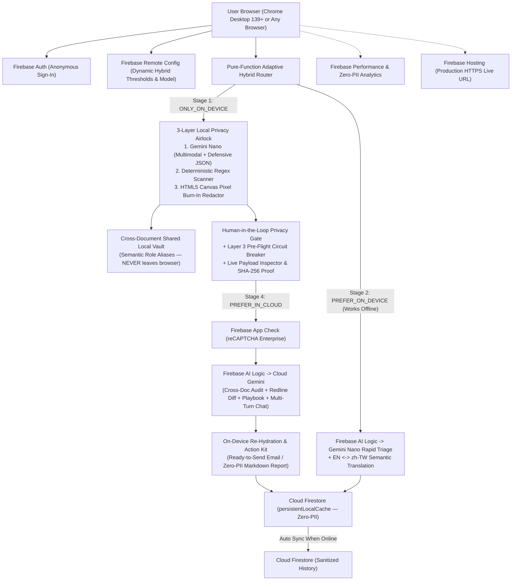

# VeilBench

**Multimodal Zero-Leak Hybrid AI Document Auditor & Negotiation Workbench**

[](./LICENSE)
[](https://firebase.google.com/docs/ai-logic)
[-141518.svg)](https://developer.chrome.com/docs/ai/built-in)

VeilBench is a privacy-first web workbench built for the **Firebase #BuildHybridAI** challenge. It enables professionals to audit sensitive contracts, clinical lab reports, and financial invoices—across both **text and scanned JPEG/PNG images**—without exposing raw Personally Identifiable Information (PII) or secrets to cloud LLMs.

Every AI inference call routes exclusively through **Firebase AI Logic (`firebase/ai`)**, orchestrating **Chrome Built-in Gemini Nano (`ONLY_ON_DEVICE` / `PREFER_ON_DEVICE`)** for local redaction, offline rapid triage, and semantic translation, and **Cloud Gemini (`PREFER_IN_CLOUD`)** protected by **Firebase App Check** for deep cross-document contradiction auditing, surgical redlines, and negotiation playbooks.

---

## Why Hybrid AI Is Essential Here

| Approach | Outcome |
| :--- | :--- |
| **Cloud-Only AI** | Fails privacy and compliance requirements—raw SSNs, IBANs, patient MRNs, and API keys leave the user's browser; fails completely offline. |
| **On-Device-Only AI** | Protects privacy and works offline, but small local context windows struggle with multi-document contradiction analysis, deep legal redlining, and multi-turn negotiation synthesis. |
| **VeilBench (Hybrid AI)** | Runs a **3-layer local privacy airlock** and **offline rapid triage** on-device via Gemini Nano, then escalates **only verified, role-aliased, pixel-burned payloads** to Cloud Gemini—and re-hydrates actionable outputs locally in the browser. |

---

## 6 Core Technical Differentiators

1. **Multimodal Text + HTML5 Canvas Pixel Burn-In Redaction**  
   Inspects both text documents and scanned JPEG/PNG documents. Sensitive image regions are permanently painted over on an offscreen HTML5 `<canvas>` (`#141518` solid burn-in with monospace role labels) so underlying pixels are irreversibly destroyed before any image leaves the browser.
2. **3-Layer Defense-in-Depth Privacy Airlock**  
   - **Layer 1 (`ONLY_ON_DEVICE` Gemini Nano)**: Contextual semantic PII extraction (names, organizations, clinical conditions, unstructured addresses) with defensive JSON repair.  
   - **Layer 2 (Local Deterministic Scanner)**: Millisecond local detection of emails, phone numbers, SSNs/national IDs, MRNs, IBANs/credit cards, currency amounts, IPv4 addresses, DOBs, and API keys (`AIza...`, `sk-...`, `ghp_...`).  
   - **Layer 3 (Pre-Flight Leak Assertion Circuit Breaker)**: A pure-function gate that inspects every outbound payload milliseconds before cloud dispatch and hard-blocks escalation if any active vault value or high-confidence secret/PII pattern remains.
3. **Cross-Document Shared Local Vault & Semantic Role Aliasing**  
   Identical entities across multiple files (e.g., a Master Consulting Agreement `.txt` and a Schedule B Quote `.png`) map deterministically to the same semantic role alias (`[PARTY_CONTRACTOR_1]`, `[PARTY_CLIENT_1]`, `[BANK_ACCOUNT_1]`). Cloud Gemini can detect cross-document financial and legal contradictions without ever seeing real identities.
4. **Verifiable Zero-Leak Proof & Live Payload Inspection**  
   Before cloud escalation, the **Live Payload Inspector** displays the exact outbound text and pixel-burned PNGs alongside a **Web Crypto SHA-256 Zero-Leak Proof** (hashing raw local input vs. sanitized outbound payload). The **X-Ray Telemetry Drawer** also exposes the exact Zero-PII JSON written to Cloud Firestore.
5. **Interactive Redline Workbench & Local Re-Hydration Action Kit**  
   Moves beyond generic summarization: provides offline-ready traffic-light risk triage, cross-document contradiction findings, interactive diff-style redline rewrites, counterparty pushback scripts, auto-sanitized multi-turn follow-up chat, and one-click local re-hydration into a ready-to-send negotiation email or Zero-PII Markdown report.
6. **English-First UI + On-Device Semantic Translation (`EN` ↔ `繁體中文`)**  
   Defaults to precise English for international review, with one-click semantic translation powered by Firebase AI Logic (`PREFER_ON_DEVICE`) so users can read localized summaries offline with zero data egress.

---

## System Architecture



---

## Firebase Services Used (8 Integrated Services)

| # | Firebase Service | Role in VeilBench |
| :-: | :--- | :--- |
| 1 | **Firebase AI Logic (`firebase/ai`)** | Sole AI inference interface (`GoogleAIBackend`) orchestrating `ONLY_ON_DEVICE`, `PREFER_ON_DEVICE`, and `PREFER_IN_CLOUD` with real-time `inferenceSource` telemetry (`ON_DEVICE` vs. `IN_CLOUD`). |
| 2 | **Firebase App Check (`firebase/app-check`)** | Protects cloud inference and backend resources via `ReCaptchaV3Provider` or `ReCaptchaEnterpriseProvider` with automatic token refresh and live status reporting in the X-Ray Telemetry bar. |
| 3 | **Cloud Firestore (`firebase/firestore`)** | Configured with `persistentLocalCache` and `persistentMultipleTabManager` for true offline-first persistence and automatic reconnect sync. Security Rules enforce per-UID isolation and reject raw PII fields. |
| 4 | **Firebase Authentication (`firebase/auth`)** | Anonymous Sign-In provides zero-friction access for reviewers while strictly isolating each user's sanitized session history by UID. |
| 5 | **Firebase Remote Config (`firebase/remote-config`)** | Dynamically tunes hybrid routing parameters (`max_on_device_chars`, `cloud_model_name`, `strict_pii_block_enabled`) without redeploying the app. |
| 6 | **Firebase Performance Monitoring (`firebase/performance`)** | Records real custom latency traces comparing `ON_DEVICE` vs. `IN_CLOUD` execution paths. |
| 7 | **Firebase Analytics (`firebase/analytics`)** | Logs strictly non-PII architectural routing telemetry (task type, inference source, and cloud-call savings counts only). |
| 8 | **Firebase Hosting (`firebase.json`)** | Serves the production HTTPS SPA with immutable static asset caching headers. |

---

## Enabling Chrome Built-in Gemini Nano (Chrome Desktop 139+)

VeilBench gracefully degrades in non-Nano browsers (Safari, Firefox, mobile, or Chrome without flags) using its Layer 2 Deterministic Shield and Firebase AI Logic cloud fallback. To experience full **on-device, zero-cost, offline Gemini Nano inference**:

1. Use **Chrome Desktop 139+** (with at least ~22 GB free disk space for the built-in model).
2. Open `chrome://flags/#gemma4-for-built-in-ai` (shown as **Gemma 4 for Built-in AI**) and set it to **Enabled** (Gemini Nano 4 on-device model).
3. Open `chrome://flags/#prompt-api-for-gemini-nano` and set it to **Enabled**.
4. Open `chrome://flags/#prompt-api-for-gemini-nano-multimodal-input` and set it to **Enabled** (enables local image inspection).
5. Relaunch Chrome and verify model status at `chrome://on-device-internals`.
6. Reload VeilBench—the top bar indicator will switch to **Nano Ready**.

---

## Local Development & App Check Setup

### Prerequisites
- Node.js `20+` and npm `10+`
- A Firebase project with **Firebase AI Logic (Gemini Developer API)**, **Anonymous Authentication**, **Cloud Firestore**, **Remote Config**, and **App Check** enabled.

### 1. Install Dependencies
```bash
npm install
```

### 2. Configure Environment Variables
Copy the template and fill in your Firebase Web App credentials (never commit `.env.local`):
```bash
cp .env.example .env.local
```

Required variables in `.env.local`:
```env
VITE_FIREBASE_API_KEY=...
VITE_FIREBASE_AUTH_DOMAIN=...
VITE_FIREBASE_PROJECT_ID=...
VITE_FIREBASE_STORAGE_BUCKET=...
VITE_FIREBASE_MESSAGING_SENDER_ID=...
VITE_FIREBASE_APP_ID=...
VITE_FIREBASE_MEASUREMENT_ID=...

# Firebase App Check ('enterprise' in production, 'v3' also supported)
VITE_APP_CHECK_PROVIDER=enterprise
VITE_RECAPTCHA_V3_SITE_KEY=...

# Local development ONLY — set to false in production builds
VITE_APP_CHECK_DEBUG_TOKEN=false
```

> **App Check Local Development**: Set `VITE_APP_CHECK_DEBUG_TOKEN=true` locally, copy the debug token printed in the browser DevTools console, and register it under **Firebase Console → App Check → Apps → Manage debug tokens**. Keep `VITE_APP_CHECK_DEBUG_TOKEN=false` for production Firebase Hosting builds.

### 3. Run Locally, Test, and Build
```bash
# Start Vite dev server
npm run dev

# Run TypeScript typecheck
npm run typecheck

# Run pure-function core engine unit tests (157 tests across 12 suites)
npm test

# Build production bundle
npm run build
```

### 4. Deploy to Firebase Hosting & Firestore Rules
```bash
firebase deploy --only firestore:rules,hosting
```

---

## Project Structure

```text
src/
├── types/          # Locked TypeScript contracts (hybrid, privacy, audit)
├── config/         # Firebase 8-service bootstrap & Remote Config loader
├── core/           # 100% pure-function privacy & hybrid routing engine (0 UI/SDK deps)
│   ├── hybridRouter.ts
│   ├── piiShield.ts
│   ├── preFlightGuard.ts
│   ├── proofGenerator.ts
│   └── canvasRedactor.ts
├── services/       # Firebase AI Logic (firebase/ai) & Zero-PII Firestore persistence
├── data/           # 3 built-in realistic sample bundles (with client-side Canvas PNG scans)
├── state/          # Unified workbench state & hybrid orchestration store
└── components/     # Swiss-precision security workbench UI (.stitch/DESIGN.md)
tests/core/         # 157 Vitest unit tests: routing, redaction, circuit breaker, SHA-256, resilience, split-knowledge, demo cache
```

---

## Security & Privacy

See [SECURITY.md](./SECURITY.md) for the complete threat model, 3-Layer Zero-Leak Airlock specification, Firestore Zero-PII enforcement guarantees, and responsible disclosure guidelines.

## License

Licensed under the **Apache License 2.0**. See [LICENSE](./LICENSE) for full terms.
